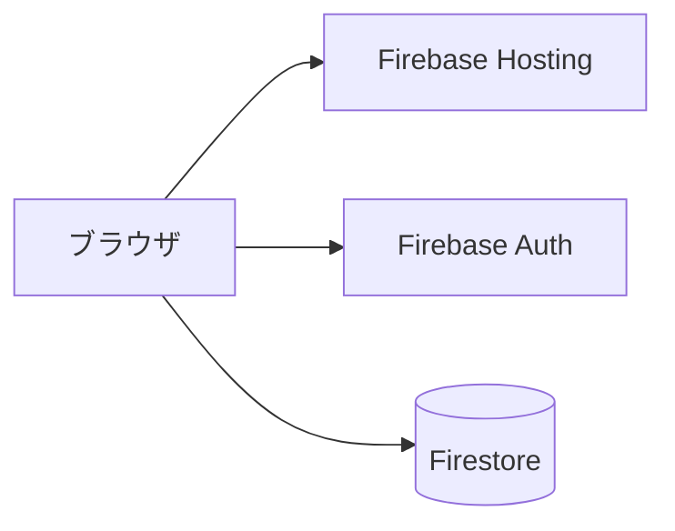

## システム構成

## 技術スタック

| レイヤ | 採用技術 | 理由 |
| --- | --- | --- |
| フロントエンド | React + Vite | 学習コストが低く高速 |
| 認証 | Firebase Auth | メール/Googleログインを標準提供 |
| データ | Firestore | サーバー管理が不要で、利用状況に応じて拡張できる |

## 決定事項

- 採用理由の詳細は ADR を参照
